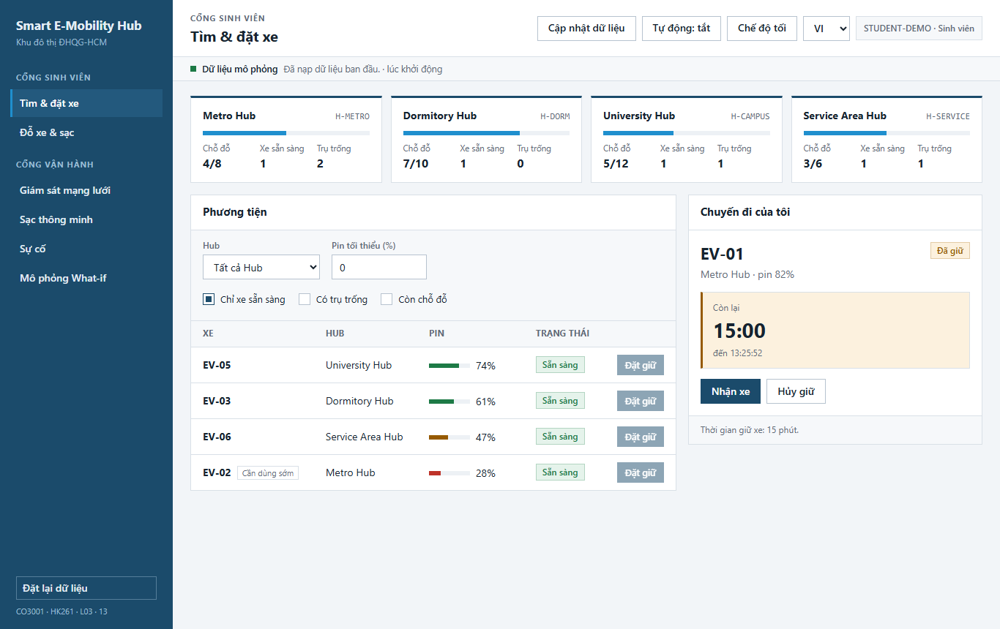
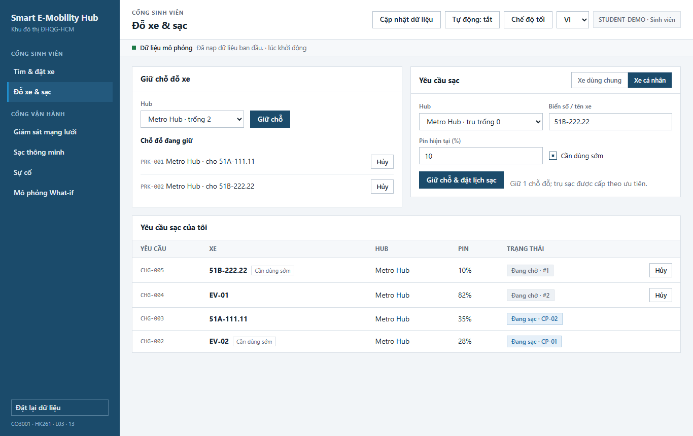
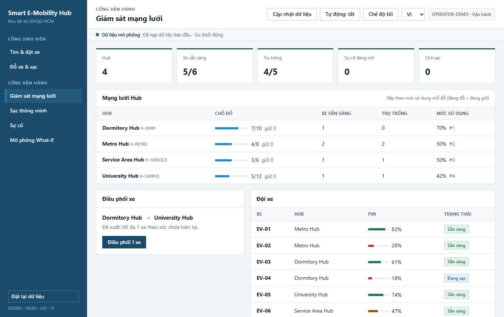
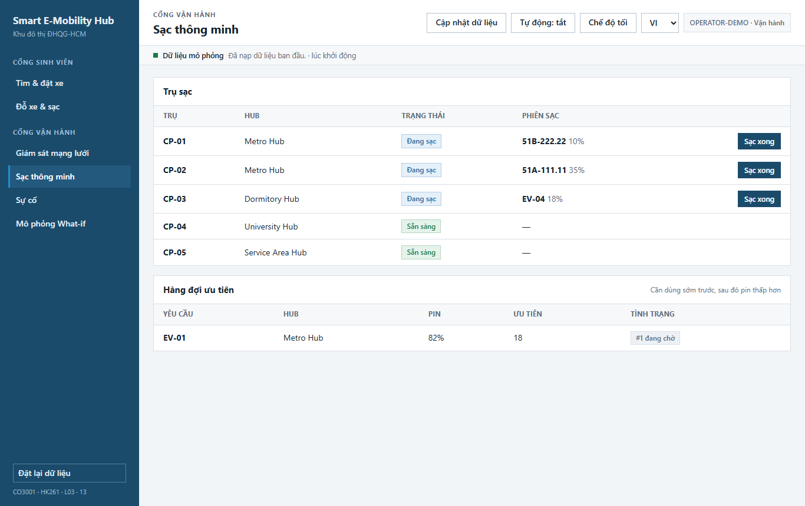
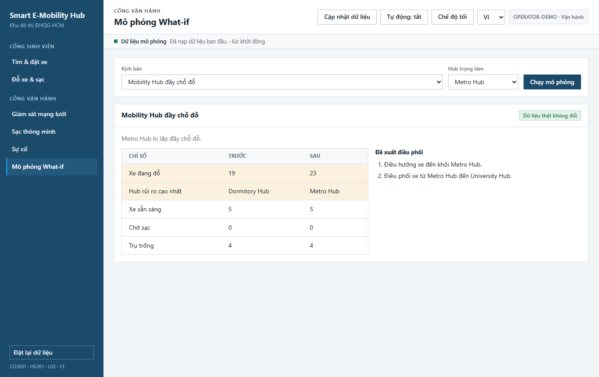
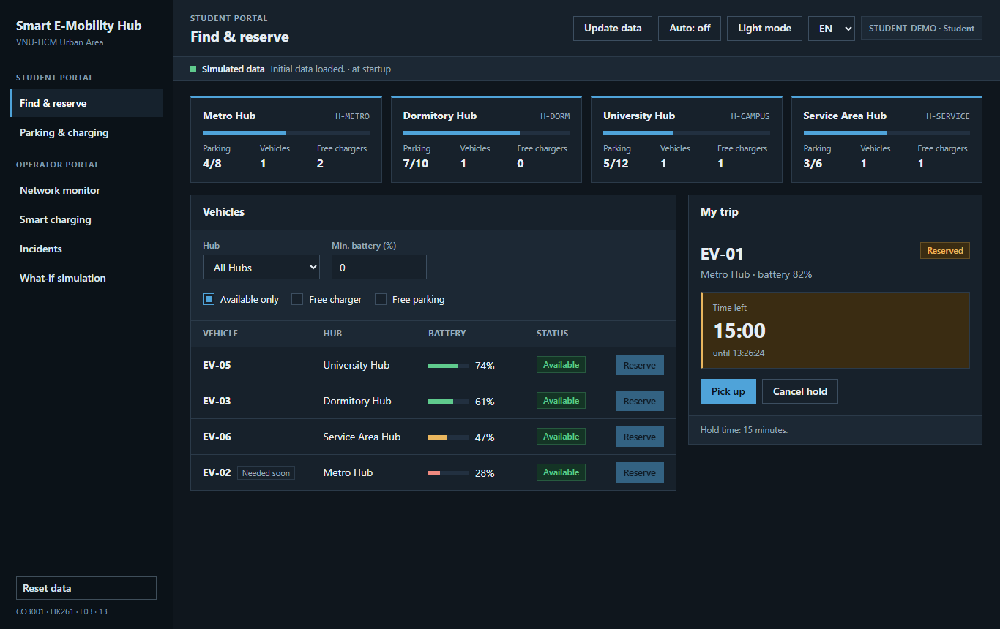

# Bằng chứng kiểm thử

Ngày chạy: **2026-11-20 (giờ Việt Nam)**. Nhánh `feature/ui-redesign`, commit được kiểm thử: **`4b08beb459e979ae0f4268534ee0c23383e17d38`** (cây làm việc sạch đối với các tệp được Git theo dõi). Các commit sau đó chỉ thêm tài liệu này và bản tóm tắt phát hành.

Môi trường: Windows 11 · Node `v24.15.0` · Python `3.14.4` · Git `2.50.0.windows.1` · Playwright (Python) `1.60.0` · Chrome `157.0.8103.79` · Edge `157.0.4341.60` (headless).

## 1. Tóm tắt

| Kiểm tra | Lệnh (từ thư mục gốc repo) | Kết quả | Mã thoát |
|---|---|---|---|
| Cú pháp mọi module | `node --check` cho 17 tệp `src/**/*.js` | **PASS** 17/17 | 0 |
| Kiểm thử đơn vị | `npm test` | **PASS 60 / FAIL 0** | 0 |
| Máy chủ tĩnh đúng lệnh tài liệu | `python -m http.server 5173 --bind 127.0.0.1` + yêu cầu HTTP | **PASS** 20/20 tài nguyên trả 200, JS có MIME `javascript` | 0 |
| Trình duyệt thật — Chrome | `python tests/e2e/browser_acceptance.py` | **PASS 101 / FAIL 0** | 0 |
| Trình duyệt thật — Edge | `python tests/e2e/browser_acceptance.py --browser msedge --no-screenshots` | **PASS 101 / FAIL 0** | 0 |
| Khoảng trắng/xung đột | `git diff --check origin/main HEAD` | **PASS** (sạch) | 0 |
| Hai PDF công khai | so SHA-256 bản commit với bản trên đĩa; quét đường dẫn máy/tệp nhúng | **PASS** khớp hoàn toàn; không có đường dẫn máy, không tệp nhúng | — |
| Quét trước khi commit | regex khóa bí mật/token, email, đường dẫn máy, số dạng MSSV (ngoài 2 PDF đã được duyệt), tệp > 300 KB | **PASS** không phát hiện | — |

## 2. Kiểm thử đơn vị (`npm test`)

```text
ℹ tests 60
ℹ pass 60
ℹ fail 0
```

Bao phủ chính: giữ xe/hết hạn (biên `expiresAt − 1 ms` / `expiresAt`), hủy giữ, một chuyến/sinh viên · nhận/trả xe và sức chứa (đang đỗ + đang giữ) · giữ/hủy chỗ đỗ · **tự cấp trụ ngay khi trống**, **trụ được giải phóng giao cho yêu cầu ưu tiên nhất**, không vượt số trụ, *Sạc xong* (xe 100%, xe cá nhân rời đi), hủy yêu cầu đang chờ, chỉ hiện xe đủ điều kiện · sự cố và **xử lý xong** (xe sửa xong, trụ khôi phục, xe hỏng giữa chuyến cần chỗ trống) · what-if trên bản sao (gồm tự cấp trụ trên bản sao) · bộ mô phỏng không vượt sức chứa, nhả trụ thì cấp ngay · đủ bản dịch VI/EN cho mọi khóa dùng trong giao diện · mọi id DOM tồn tại · điều hướng khớp trang · **CSS không có góc bo**.

## 3. Trình duyệt thật (Playwright)

| Kịch bản | Số kiểm tra (PASS trên cả Chrome và Edge) |
|---|---|
| HTTP: 19 tài nguyên trả 200, giống từng byte, MIME đúng | 1 |
| S1 Khám phá, tiếng Việt mặc định (AT-01..03) | 6 |
| S2 Giữ → nhận → trả, đếm ngược, hồi quy "ô Hub trả xe giữ nguyên khi vẽ lại" (AT-04, 06, 07) | 8 |
| S3 Hết hạn `?holdSeconds=10`, hủy giữ, giá trị ngoài khoảng | 5 |
| S4 Sức chứa chỗ đỗ, trả về Hub đầy, xếp hạng, hủy chỗ đỗ (AT-05, 07, 12) | 7 |
| S5 Yêu cầu sạc, ưu tiên, *Sạc xong*, hủy yêu cầu (AT-08, 09, 15) | 12 |
| S5b Xe đang được giữ bị *Tạm hoãn*, không nhận trụ | 2 |
| S6 KPI, điều phối, báo sự cố, **xử lý xong** (AT-10, 11, 13, 14) | 11 |
| S7 Năm kịch bản what-if, dữ liệu thật không đổi (AT-16..18) | 6 |
| S8 Cập nhật thủ công ×4 và tự động trong 20 giây (AT-19) | 7 |
| S9 Đặt lại dữ liệu | 1 |
| S10 Chế độ tối và VI/EN (AT-20) | 5 |
| S11 **Phát lại nguyên kịch bản demo** trên một lần tải trang | 25 |
| S12 Màn hình 390 px không cuộn ngang (4 trang) | 4 |
| Console/network: không lỗi, không cảnh báo, không request hỏng | 1 |
| **Tổng** | **101** |

```text
Browser: chrome 157.0.8103.79
SUMMARY: 101 PASS / 0 FAIL / 101 checks
Browser: msedge 157.0.4341.60
SUMMARY: 101 PASS / 0 FAIL / 101 checks
```

### Ảnh chụp (Chrome, 1366×860; ảnh 8 ở 390×844)

| | |
|---|---|
|  |  |
| 1. Tìm & đặt xe — chuyến đi đang giữ, đếm ngược | 2. Đỗ xe & sạc — chỗ đỗ đang giữ, yêu cầu sạc |
|  |  |
| 3. Giám sát mạng lưới — KPI, Hub, điều phối, đội xe | 4. Sạc thông minh — trụ, phiên sạc, hàng đợi ưu tiên |
|  |  |
| 5. Sự cố — đã xử lý xong | 6. What-if — trước/sau và đề xuất |
|  |  |
| 7. English + Dark | 8. Màn hình hẹp |

## 4. Lỗi người dùng báo và cách xác nhận đã sửa

| Báo cáo | Nguyên nhân gốc (đã tái hiện) | Kiểm thử chứng minh |
|---|---|---|
| "Gửi yêu cầu sạc không được" | Ô chọn xe mặc định là xe *đã giữ* hoặc *đang sạc* nên luôn bị từ chối; khi gửi được thì phải chờ vận hành bấm "Apply schedule"; phiên sạc không bao giờ kết thúc | S5 (`only eligible vehicles are offered`, `free charger assigned immediately`, `finishing CP-01 hands it to the top request`); unit `AT-08 / D-015…`, `AT-15 / FR-15…` |
| "Báo trụ ngừng / xe hỏng xong không mở lại được" | Không có thao tác xử lý xong sự cố | S6 (`repair returns EV-02 to service`, `restore returns CP-01 to service`); unit `D-016: …` (3 ca) |
| "Web nhiều chữ, rối mắt" | Mọi chức năng trên một trang ~800 chữ | Trang *Tìm & đặt xe* còn ~110 chữ; 6 trang qua thanh bên; ảnh mục 3 |
| "Ô hình chữ nhật để góc nhọn" | CSS cũ bo góc 8–12 px | Unit `owner requirement: boxes have square corners` (mọi `border-radius` = 0) |

## 5. Bảo toàn tệp của nhóm

Ảnh chụp SHA-256 của **152** tệp chưa theo dõi/bị bỏ qua (lấy trước mọi thay đổi) được so lại trước khi commit: **150 giống từng byte**. Hai khác biệt:

- `docs/agent-handoff/manifest.json` — ghi chú làm việc cục bộ, được cập nhật có chủ đích ở lần phát hành trước (không phải bài của nhóm, không được đẩy lên).
- `submission3/L03_13.pdf` — **chủ repo đã xóa qua Windows Explorer lúc 07:39 ngày 2026-11-20** (đang nằm trong Thùng rác). Đây là bản build lỗi trang 7; một bản giống hệt từng byte vẫn còn ở `submission3/report_builder/out/L03_13.pdf`.

Không tệp nào trong `submission2/` hoặc `submission3/` bị công việc này sửa, di chuyển hay xóa.

## 6. Báo cáo được công khai

| Tệp | Trang | SHA-256 |
|---|---|---|
| `submission2/Phase2_L03_13.pdf` | 32 | `cb3a633848cad03b…` |
| `submission3/L03_13 (1).pdf` (bản đã nộp LMS theo xác nhận của chủ repo) | 40 | `1c786f443b5e4a5c…` |

Metadata chỉ ghi tiêu đề và "Group 13, Class L03"; không có đường dẫn máy hay tệp nhúng.

## 7. Chưa chạy (NOT RUN)

| Hạng mục | Lý do / cách làm |
|---|---|
| Người thật tự bấm toàn bộ kịch bản trên máy trình chiếu | **NOT RUN** — kịch bản đã được phát lại tự động (S11); nhóm cần tập ít nhất 1 lần theo [DEMO_CHECKLIST.md](DEMO_CHECKLIST.md). |
| Firefox / Safari, điện thoại thật | **NOT RUN** — chỉ Chrome/Edge và khung nhìn 390 px mô phỏng. |
| Nhiều người dùng trên nhiều thiết bị | **NOT RUN / ngoài phạm vi** — mỗi tab có dữ liệu riêng. |
| Kiểm định khả năng truy cập (WCAG) đầy đủ, đo hiệu năng | **NOT RUN**. |
| Xác minh bản đã nộp trên LMS | **NOT RUN** — dựa trên xác nhận của chủ repo. |
