# Bằng chứng kiểm thử

Ngày chạy: **2026-11-21 (giờ Việt Nam)**. Nhánh `feature/uc-ui-sync`, commit được kiểm thử: **`9a7ad682d0c0a9224d2cb3aafc0e27926ed92c83`** (cây làm việc sạch đối với các tệp được Git theo dõi). Các commit sau đó chỉ thêm tài liệu này, bản tóm tắt phát hành và danh mục phát hành.

Môi trường: Windows 11 · Node `v24.15.0` · Python `3.14.4` · Git `2.50.0.windows.1` · Playwright (Python) `1.60.0` · Chrome `157.0.8103.79` · Edge `157.0.4341.60` (headless).

## 1. Tóm tắt

| Kiểm tra | Lệnh (từ thư mục gốc repo) | Kết quả | Mã thoát |
|---|---|---|---|
| Cú pháp mọi module | `node --check` cho 26 tệp `src/**/*.js` | **PASS** 26/26 | 0 |
| Kiểm thử đơn vị | `npm test` | **PASS 73 / FAIL 0** | 0 |
| Máy chủ tĩnh đúng lệnh tài liệu | `python -m http.server 5173 --bind 127.0.0.1` + yêu cầu HTTP | **PASS** 28/28 tài nguyên trả 200, JS có MIME `javascript`; cổng 5173 trống trước khi chạy, chỉ dừng đúng tiến trình do lần kiểm tra mở | 0 |
| Trình duyệt thật — Chrome | `python tests/e2e/browser_acceptance.py` | **PASS 130 / FAIL 0** | 0 |
| Trình duyệt thật — Edge | `python tests/e2e/browser_acceptance.py --browser msedge --no-screenshots` | **PASS 130 / FAIL 0** | 0 |
| Khoảng trắng/xung đột | `git diff --check origin/main HEAD` | **PASS** (sạch) | 0 |
| Báo cáo đã nộp | `git status` của `submission2/`, `submission3/` | **PASS** không có thay đổi; hai PDF công khai giữ nguyên | — |
| Quét trước mỗi commit | regex khóa bí mật/token, email, đường dẫn máy, số dạng MSSV, tên thư mục làm việc cục bộ, tệp lớn | **PASS** không phát hiện (tệp lớn nhất 113 KB) | — |

## 2. Kiểm thử đơn vị (`npm test`)

```text
ℹ tests 73
ℹ pass 73
ℹ fail 0
```

| Tệp | Nội dung chính |
|---|---|
| `hubService.test.js` | 12 Hub, Haversine, `validateLocation` (E2, bán kính 0.1–5 km), Hub trong bán kính gần nhất trước, E1, chỗ trả xe gần điểm đến, lọc loại xe/pin, sức chứa có tính chỗ đang giữ |
| `reservationService.test.js` | **TC-UC04-01..11** của phụ lục Submission #3, E1, một chuyến/sinh viên, nhận/trả xe, giữ chỗ đỗ, rút yêu cầu sạc khi nhận xe |
| `chargingService.test.js` | Ưu tiên ADR-05, khung giờ và sức chứa, E1/E2/A1, đặt lịch sau/hiện tại, khung bắt đầu/kết thúc + thông báo, cấp cổng theo ưu tiên, xe dùng chung do vận hành xếp lịch, tạm hoãn (D-009), hủy/dời, tối ưu lịch |
| `operatorService.test.js` | Cảnh báo theo ngưỡng cấu hình, KPI, kế hoạch điều phối, vòng đời lệnh điều chuyển, vòng đời sự cố (nhánh sửa chữa và nhánh vận hành), phiên sạc chuyển cổng khi cổng hỏng, xe hỏng giữa chuyến cần chỗ trống |
| `simulationService.test.js` | `validateParams`, 5 mẫu chạy trên bản sao (dữ liệu thật giống từng byte), nhãn điểm nghẽn/dư thừa, đề xuất có nhãn, quá thời gian, lưu kịch bản, áp dụng đề xuất |
| `simulatorService.test.js` | 4 pha Data Simulator, không lấp chỗ đang giữ, không đụng cổng đang sạc, mô phỏng E2/E3 |
| `i18n.test.js` | Đủ khóa VI/EN, mọi mã kết quả có bản dịch, **tên trang tiếng Anh = tên use case** |
| `page.test.js` | `node --check`, id duy nhất, mọi id/thao tác trên giao diện đều có xử lý, 11 trang khớp điều hướng, **CSS không bo góc** |

## 3. Trình duyệt thật (Playwright)

| Kịch bản | Số kiểm tra (PASS trên cả Chrome và Edge) |
|---|---|
| HTTP: tài nguyên trả 200, giống từng byte, MIME đúng | 1 |
| S1 UC-02 Find Suitable Hub / Vehicle (AT-01..03, E1, E2, A2) | 11 |
| S2 UC-04/06/07 xác nhận, A1, A2, đặt, nhận, trả, lịch sử | 11 |
| S3 UC-04 A3 hết hạn, E2, E3 | 7 |
| S4 UC-05 Reserve Parking Space (AT-05) | 4 |
| S5 UC-09 Schedule Private EV Charging (AT-08, AT-09, A1, A3, E2) | 12 |
| S6 Manage Smart Charging (AT-11, AT-15) | 10 |
| S7 Monitor Network Status (AT-10..12) | 6 |
| S8 Redistribute Vehicles + Execute Redistribution Task (AT-13, AT-21) | 8 |
| S9 UC-15 Handle Operational Incident + Resolve Assigned Incident (AT-14, AT-22) | 11 |
| S10 UC-17 Run What-if Simulation (AT-16..18) | 11 |
| S11 Data Simulator, đặt lại, chế độ tối, VI/EN, tên trang = tên use case (AT-19, AT-20) | 7 |
| S12 **Phát lại nguyên kịch bản demo** trên một lần tải trang | 23 |
| S13 Màn hình 390 px không cuộn ngang (7 trang) | 7 |
| Console/network: không lỗi, không cảnh báo, không request hỏng | 1 |
| **Tổng** | **130** |

```text
Browser: chrome 157.0.8103.79
SUMMARY: 130 PASS / 0 FAIL / 130 checks
Browser: msedge 157.0.4341.60
SUMMARY: 130 PASS / 0 FAIL / 130 checks
```

### Ảnh chụp (Chrome, 1366×860; ảnh 11 ở 390×844)

| | |
|---|---|
| 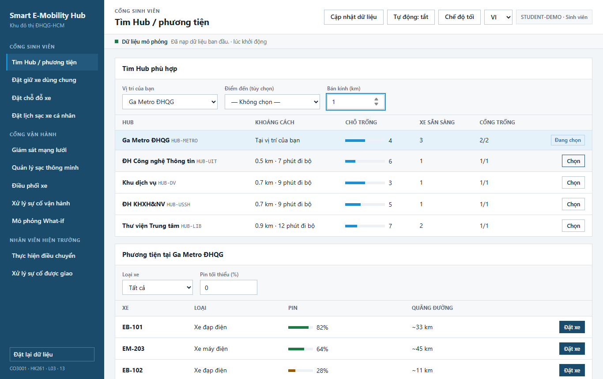 | 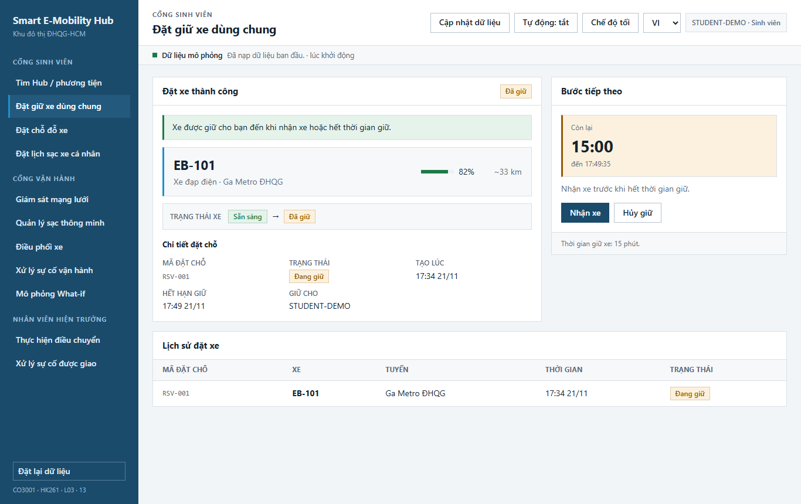 |
| 1. Tìm Hub / phương tiện (UC-02) | 2. Đặt xe thành công (UC-04) |
| 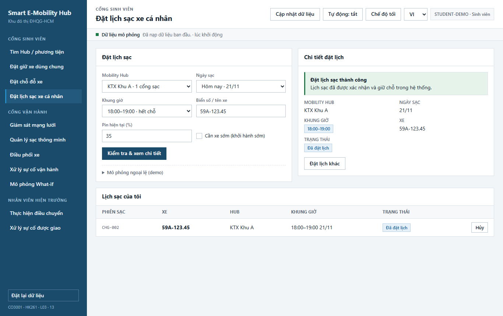 | 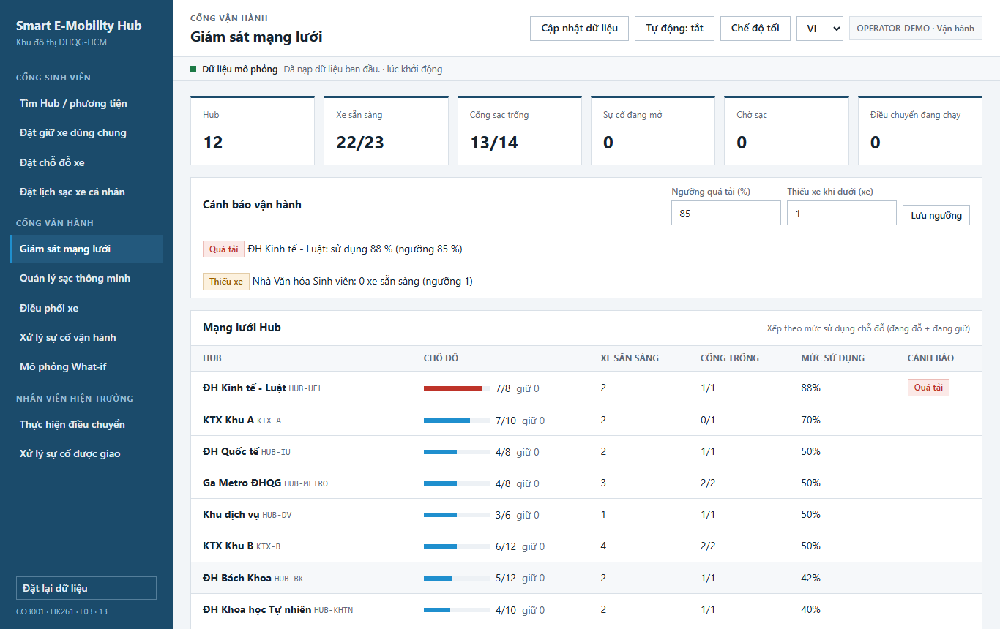 |
| 3. Đặt lịch sạc thành công (UC-09) | 4. Giám sát mạng lưới, cảnh báo theo ngưỡng |
| 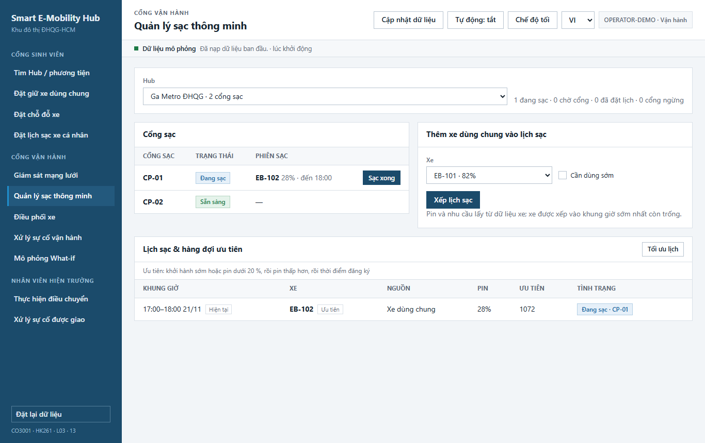 | 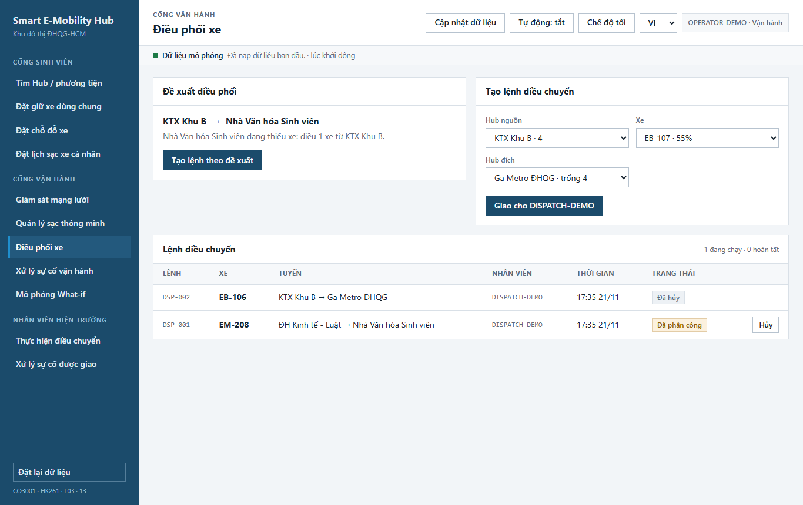 |
| 5. Quản lý sạc thông minh | 6. Điều phối xe, lệnh điều chuyển |
| 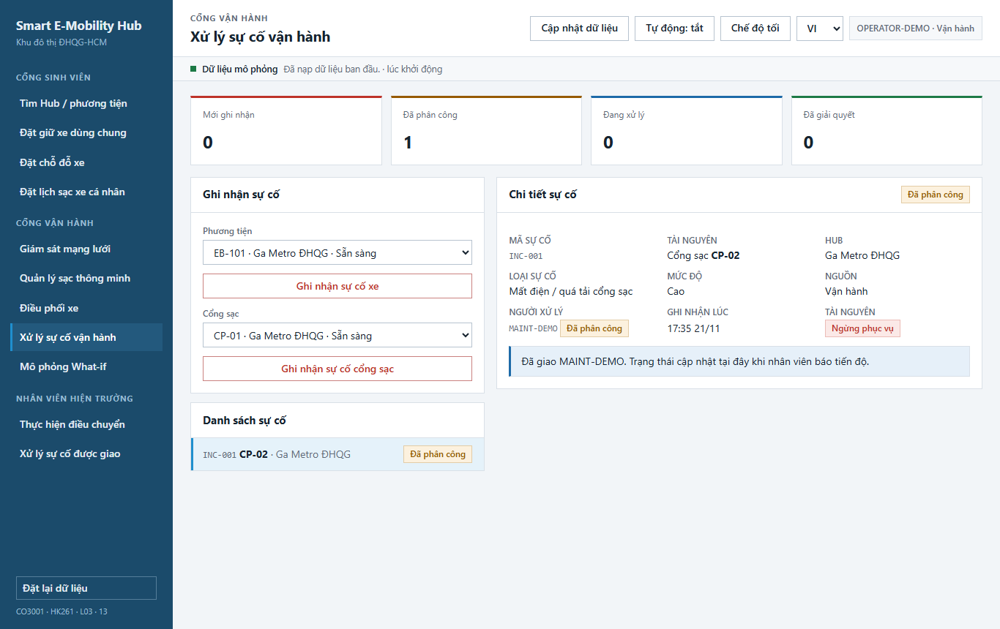 | 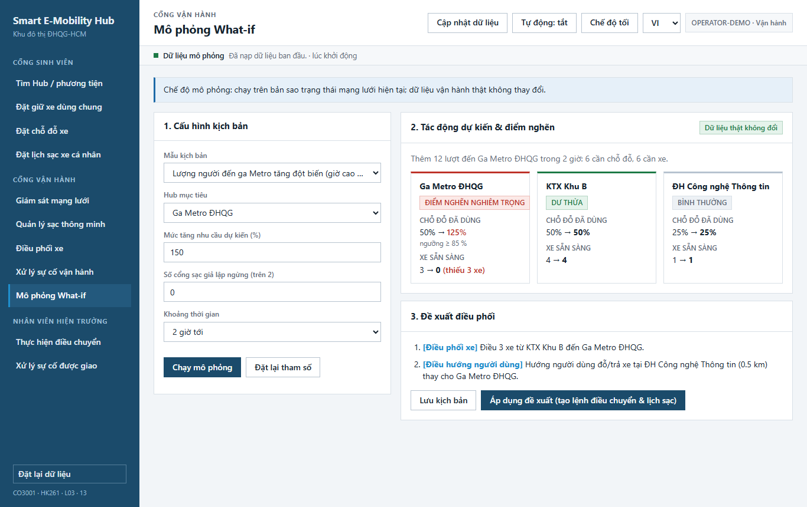 |
| 7. Xử lý sự cố vận hành (UC-15) | 8. Mô phỏng What-if (UC-17) |
| 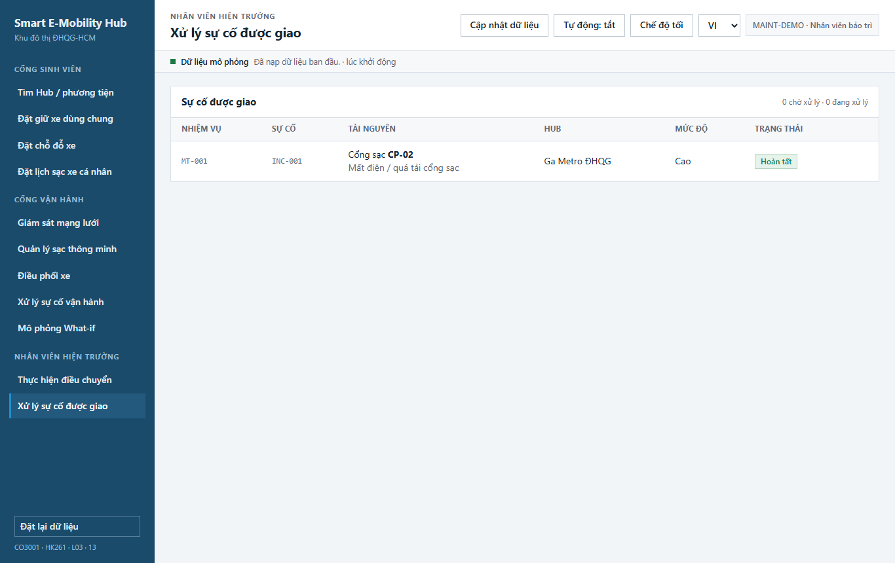 | 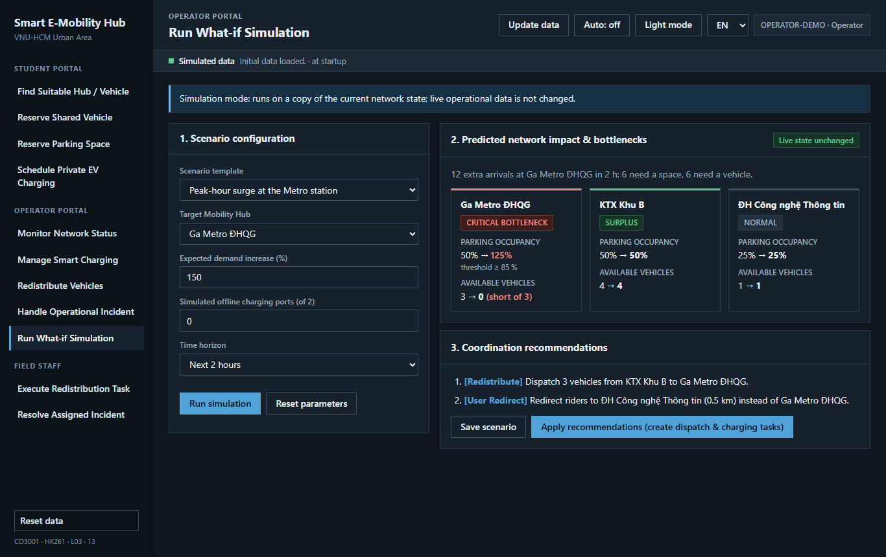 |
| 9. Nhân viên bảo trì | 10. English + Dark: tên trang = tên use case |
| 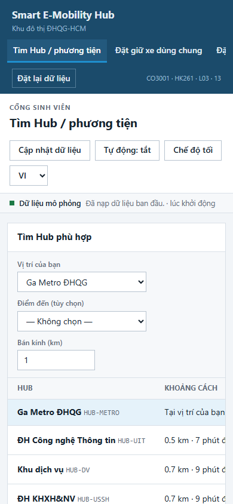 | |
| 11. Màn hình hẹp | |

## 4. Đối chiếu với báo cáo đã nộp

Chi tiết từng use case, từng bước và các điểm lệch nằm trong PDF: [UC_UI_PDF_SYNC.md](../UC_UI_PDF_SYNC.md). Những phần trước đây chỉ có trong thiết kế (khung giờ sạc, giao việc bảo trì, lưu/áp dụng kịch bản What-if, lệnh điều chuyển cho nhân viên điều phối) nay đã chạy được và có kiểm thử ở mục 2 và 3.

## 5. Bảo toàn tệp của nhóm

Ảnh chụp SHA-256 của **152** tệp chưa theo dõi/bị bỏ qua (lấy trước mọi thay đổi ở lần làm việc đầu tiên) được so lại trước khi commit: **150 giống từng byte**. Hai khác biệt (không đổi so với lần trước):

- Một tệp ghi chú làm việc cục bộ (nằm trong nhóm tệp LOCAL-ONLY của [manifest](../RELEASE_MANIFEST.md)) — không phải bài của nhóm, không được đẩy lên.
- `submission3/L03_13.pdf` — **chủ repo đã xóa qua Windows Explorer lúc 07:39 ngày 2026-11-20**; một bản giống hệt từng byte vẫn còn ở `submission3/report_builder/out/L03_13.pdf`.

Không tệp nào trong `submission2/` hoặc `submission3/` bị công việc này sửa, di chuyển hay xóa.

## 6. Báo cáo được công khai

| Tệp | Trang | SHA-256 |
|---|---|---|
| `submission2/Phase2_L03_13.pdf` | 32 | `cb3a633848cad03b…` |
| `submission3/L03_13 (1).pdf` (bản đã nộp LMS theo xác nhận của chủ repo) | 40 | `1c786f443b5e4a5c…` |

Hai tệp không thay đổi trong lần đồng bộ này.

## 7. Chưa chạy (NOT RUN)

| Hạng mục | Lý do / cách làm |
|---|---|
| Người thật tự bấm toàn bộ kịch bản trên máy trình chiếu | **NOT RUN** — kịch bản đã được phát lại tự động (S12); nhóm cần tập ít nhất 1 lần theo [DEMO_CHECKLIST.md](DEMO_CHECKLIST.md). |
| Phiên sạc tự kết thúc lúc chuyển giờ trong trình duyệt | Kiểm thử bằng unit test với đồng hồ cố định; bản chạy trình duyệt tránh 20 giây cuối mỗi giờ. |
| Firefox / Safari, điện thoại thật | **NOT RUN** — chỉ Chrome/Edge và khung nhìn 390 px mô phỏng. |
| Nhiều người dùng trên nhiều thiết bị | **NOT RUN / ngoài phạm vi** — mỗi tab có dữ liệu riêng; E3 được mô phỏng. |
| Kiểm định khả năng truy cập (WCAG) đầy đủ, đo hiệu năng | **NOT RUN**. |
| Xác minh bản đã nộp trên LMS | **NOT RUN** — dựa trên xác nhận của chủ repo. |
