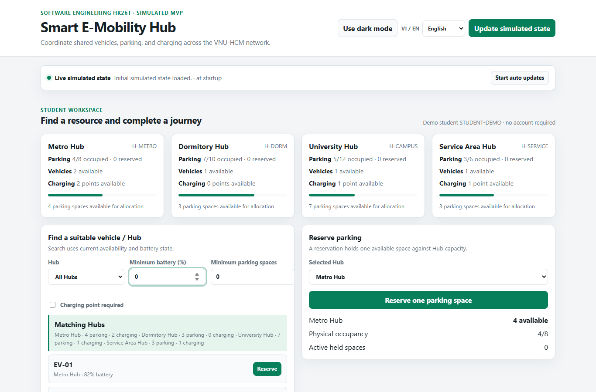
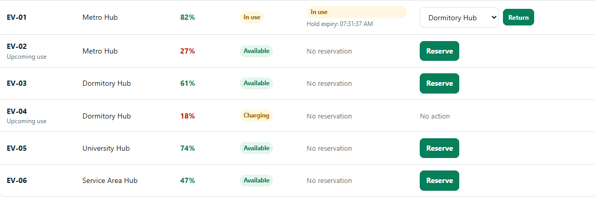
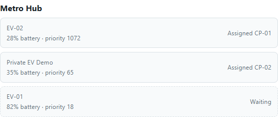
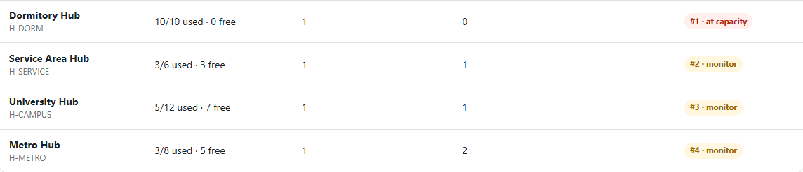
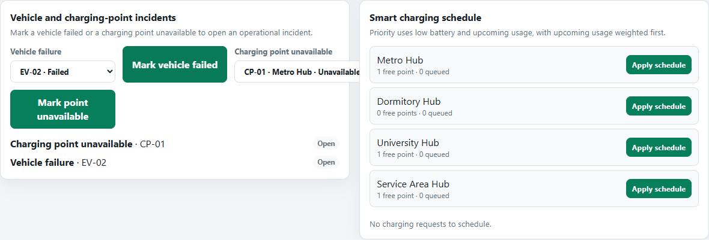
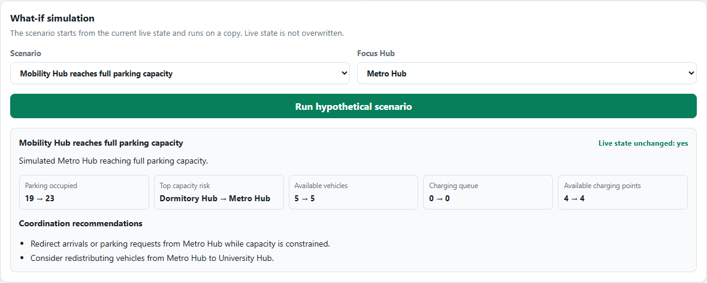
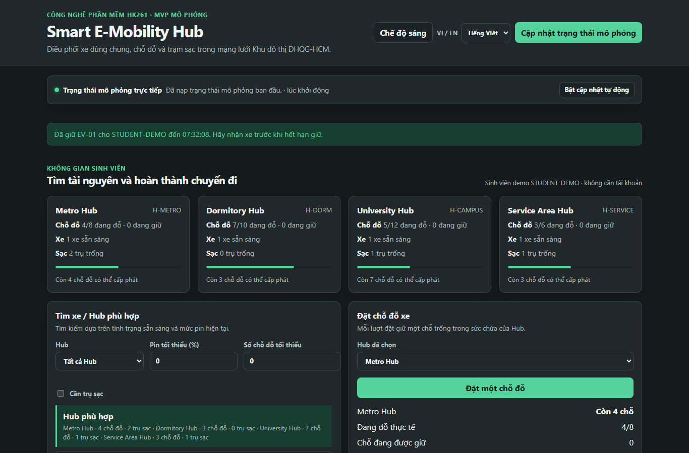
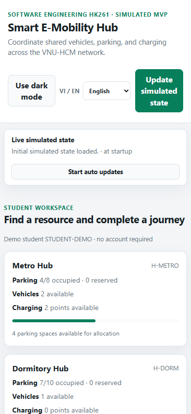

# Bằng chứng kiểm thử

Ngày chạy: **2026-11-20 (giờ Việt Nam)**. Nhánh `release/demo-readiness`, commit được kiểm thử: **`841246eaeada9162f11b9b27ed4088937ee41c6a`** (mã nguồn và test giống hệt từ commit `bb842eb`; các commit sau chỉ đổi tài liệu). Cây làm việc sạch đối với các tệp được Git theo dõi khi chạy.

Môi trường: Windows 11, PowerShell/Git Bash · Node `v24.15.0` · Python `3.14.4` · Git `2.50.0.windows.1` · Playwright (Python) `1.60.0` · Chrome `157.0.8103.79` · Edge `157.0.4341.60` (cả hai chạy headless).

## 1. Tóm tắt

| Kiểm tra | Lệnh (từ thư mục gốc repo) | Kết quả | Mã thoát |
|---|---|---|---|
| Cú pháp mọi module | `node --check` cho 14 tệp `src/**/*.js` | **PASS** 14/14 | 0 |
| Kiểm thử đơn vị | `npm test` | **PASS 47 / FAIL 0** | 0 |
| Máy chủ tĩnh đúng lệnh tài liệu | `python -m http.server 5173 --bind 127.0.0.1` + `curl` | **PASS** 17/17 tài nguyên trả 200, JS có MIME `javascript` | 0 |
| Trình duyệt thật — Chrome | `python tests/e2e/browser_acceptance.py` | **PASS 93 / FAIL 0** | 0 |
| Trình duyệt thật — Edge | `python tests/e2e/browser_acceptance.py --browser msedge --no-screenshots` | **PASS 93 / FAIL 0** | 0 |
| Script baseline của đợt audit trước | (11 ca, chạy lại nguyên văn) | **10 PASS / 1 FAIL** — FAIL do thay đổi quy tắc có chủ đích, xem mục 4 | 1 |
| Khoảng trắng/xung đột | `git diff --check HEAD~6 HEAD` | **PASS** (sạch) | 0 |
| Bảo toàn tệp của nhóm | `sha256sum --check` trên ảnh chụp 152 tệp | **PASS** 152/152 giống từng byte | 0 |
| Quét trước khi commit | regex khóa bí mật/token, email, đường dẫn máy, số dạng MSSV, tệp > 300 KB | **PASS** không phát hiện | — |

## 2. Kiểm thử đơn vị (`npm test`)

```text
ℹ tests 47
ℹ suites 0
ℹ pass 47
ℹ fail 0
ℹ cancelled 0
ℹ skipped 0
ℹ todo 0
```

Bao phủ chính: giữ xe ghi `createdAt/expiresAt` (15 phút) · sinh viên thứ hai không giữ được xe đã giữ (NFR-02) · **biên hết hạn**: còn hiệu lực ở `expiresAt − 1 ms`, hết hạn đúng `expiresAt` · nhận xe sai người / hết hạn bị từ chối · trả xe về Hub đầy (đang đỗ + đang giữ) bị từ chối · giữ chỗ đỗ không vượt sức chứa · ưu tiên sạc và **không phân quá số trụ trống** · **xe đang được giữ/hỏng/đã chuyển Hub không được phân trụ** · không cho 2 yêu cầu mở cho một xe · kiểm tra đầu vào xe cá nhân · sự cố xe/trụ · điều phối xe tôn trọng sức chứa · 5 kịch bản what-if không đổi trạng thái thật · bộ mô phỏng không vượt sức chứa khi có chỗ đang giữ · chiếm trụ mô phỏng chỉ tạm thời · từ điển EN/VI đầy đủ · mọi id DOM tồn tại · `node --check` mọi module.

## 3. Trình duyệt thật (Playwright, Chrome 157 và Edge 157)

| Kịch bản | Số kiểm tra (đều PASS trên cả hai trình duyệt) |
|---|---|
| HTTP: 16 tài nguyên trả 200, giống từng byte, MIME đúng | 1 |
| S1 Khám phá (AT-01..03) | 4 |
| S2 Giữ → nhận → trả xe (AT-04, 06, 07), gồm hồi quy "ô chọn Hub trả xe giữ nguyên sau khi vẽ lại" | 9 |
| S3 Hết hạn giữ với `?holdSeconds=10`, giá trị ngoài khoảng bị bỏ qua | 5 |
| S4 Sức chứa chỗ đỗ, trả xe về Hub đầy, xếp hạng rủi ro (AT-05, 07, 12) | 5 |
| S5 Yêu cầu sạc, kiểm tra đầu vào, ưu tiên và công suất (AT-08, 09, 15) | 10 |
| S5b Xe đang được giữ bị "On hold", không chiếm trụ | 2 |
| S6 Chỉ số, điều phối, sự cố (AT-10, 11, 13, 14) | 8 |
| S7 Năm kịch bản what-if, trạng thái thật không đổi (AT-16..18) | 5 |
| S8 Cập nhật mô phỏng thủ công ×4 và tự động trong 20 giây (AT-19) | 8 |
| S9 Dark mode và VI/EN, thông báo được dịch (AT-20) | 7 |
| S10 Màn hình hẹp 390 px không cuộn ngang | 1 |
| S11 **Phát lại nguyên kịch bản demo** trên một lần tải trang | 27 |
| Console/network: không lỗi, không cảnh báo, không request hỏng | 1 |
| **Tổng** | **93** |

Dòng cuối của cả hai lần chạy:

```text
Browser: chrome 157.0.8103.79
SUMMARY: 93 PASS / 0 FAIL / 93 checks
Browser: msedge 157.0.4341.60
SUMMARY: 93 PASS / 0 FAIL / 93 checks
```

### Ảnh chụp (Chrome, 1366×900; ảnh 8 ở 390×844)

| | |
|---|---|
|  |  |
| 1. Tổng quan, English + Light | 2. EV-01 *In use*, ô chọn Hub trả xe |
|  |  |
| 3. Lịch sạc Metro: EV-02→CP-01, Private EV→CP-02, EV-01 chờ | 4. Dormitory #1 *at capacity* |
|  |  |
| 5. Sự cố và lịch sạc | 6. What-if "full parking", *Live state unchanged: yes* |
|  |  |
| 7. Tiếng Việt + Dark | 8. Màn hình hẹp |

## 4. So sánh với baseline của đợt audit trước

Script 11 ca của đợt audit (chạy trên commit `04bf4c1`: 8 PASS / 3 FAIL) được chạy lại nguyên văn trên mã mới:

```text
PASS HUB_SEARCH
PASS RESERVE_EXPIRY
PASS PICKUP_RETURN
PASS PARKING_GUARD
FAIL CHARGE_PRIVATE_PRIORITY_CAPACITY | Cannot read properties of undefined (reading 'chargingPointId')
PASS INCIDENTS_REDISTRIBUTION
PASS WHAT_IF_5_ISOLATED
PASS SIMULATOR_4_PHASES
PASS GUARD_QUEUED_THEN_RESERVED
PASS GUARD_FAILED_QUEUED_CHARGE
PASS GUARD_SIMULATOR_PARKING
```

- Ba lỗi đã biết **GUARD_QUEUED_THEN_RESERVED**, **GUARD_FAILED_QUEUED_CHARGE**, **GUARD_SIMULATOR_PARKING** chuyển từ FAIL sang **PASS**.
- **CHARGE_PRIVATE_PRIORITY_CAPACITY** FAIL vì ca này gửi yêu cầu sạc cho EV-01 với pin gõ tay **15%** trong khi pin ghi nhận của EV-01 là **82%**. Theo D-008, xe dùng chung nay dùng pin ghi nhận, nên thứ tự đúng là EV-02 (28%, sắp dùng) → CP-01, xe cá nhân 35% → CP-02, EV-01 (82%) chờ. Thuộc tính ưu tiên và công suất tương ứng được kiểm bởi `AT-15 / FR-15: upcoming usage first, then lowest battery; never more assignments than free points` (PASS). Đây là thay đổi quy tắc có chủ đích, không phải lỗi hồi quy.

## 5. Bảo toàn tệp của nhóm

Trước mọi thay đổi đã chụp SHA-256 của **152** tệp chưa theo dõi/bị bỏ qua (toàn bộ `submission2/`, `submission3/`, `submission3.zip`, log, ghi chú làm việc). Kiểm tra lại trước khi commit:

```text
PRESERVATION: all 152 pre-existing untracked/ignored files present and byte-identical
```

Không tệp nào trong `submission2/` hoặc `submission3/` bị sửa, di chuyển hay xóa; nhánh `main` cục bộ vẫn ở `04bf4c1`. Quyết định công bố từng tệp: [../RELEASE_MANIFEST.md](../RELEASE_MANIFEST.md).

## 6. Báo cáo Submission #3 (chỉ kiểm tra, không sửa)

- `submission3/L03_13.pdf` (40 trang, SHA-256 `19e4504998c9…`): **trang 7 (Development / Implementation View) hiển thị thành các khối đen** (tỉ lệ điểm ảnh tối 0.307 khi render bằng PyMuPDF; ảnh nguồn `Development_Implementation_View.png` không có kênh alpha và 63% điểm ảnh màu đen).
- `submission3/L03_13 (1).pdf` (40 trang, SHA-256 `1c786f443b5e…`): **chữ giống hệt trên cả 40 trang**, chỉ ảnh trang 7 khác và **đọc được** (tỉ lệ điểm ảnh tối 0.001).
- Không có bằng chứng trong repo về tệp nào đã được nộp lên LMS. Trưởng nhóm cần xác nhận.

## 7. Chưa chạy (NOT RUN)

| Hạng mục | Lý do / cách làm |
|---|---|
| Người thật tự bấm toàn bộ kịch bản trên máy trình chiếu | **NOT RUN** — kịch bản đã được phát lại tự động (S11) nhưng nhóm cần tập dượt ít nhất 1 lần trên máy và màn chiếu thật theo [DEMO_CHECKLIST.md](DEMO_CHECKLIST.md). |
| Firefox / Safari | **NOT RUN** — chỉ kiểm Chrome và Edge (Chromium). |
| Điện thoại/máy tính bảng thật | **NOT RUN** — chỉ mô phỏng khung nhìn 390 px. |
| Nhiều người dùng đồng thời trên nhiều thiết bị | **NOT RUN / ngoài phạm vi** — mỗi tab có trạng thái riêng, không có máy chủ chung. |
| Biên dịch lại LaTeX / sửa hình trang 7 báo cáo | **NOT RUN** — không được phép sửa bản nộp khi chưa có xác nhận của nhóm. |
| Kiểm định khả năng truy cập (WCAG) đầy đủ, đo hiệu năng | **NOT RUN** — chỉ sửa độ tương phản nút ở Dark mode. |
